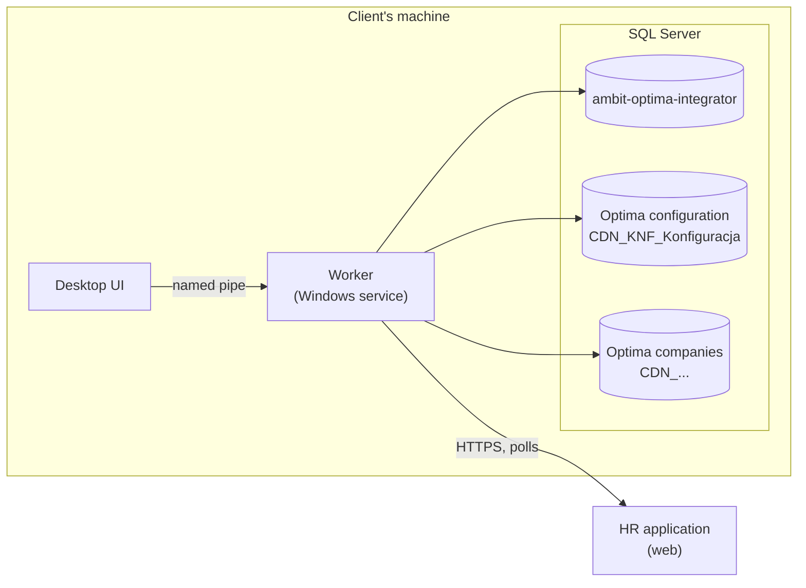

# Architecture

## Processes

- **Worker** - a Windows service under its own virtual account (`NT SERVICE\AmbitOptimaIntegrator`). It signs in to SQL
  Server with that Windows identity; the settings hold no SQL user or password.
- **Desktop UI** - shows whether the service works and whether its SQL account has more rights than it should. It sends
  command names over IPC, never SQL.
- **Setup** - run by the installer as an administrator: creates and migrates the integrator's database, grants rights,
  registers the service and writes its settings.

## Operations

The Worker asks the HR application for work (`claim`) every `AmbitApi:PollIntervalMilliseconds` (500 ms by default)
while nothing waits, at once after an operation, and after `AmbitApi:RetrySeconds` when the application cannot be
reached or refuses the token. An operation has a kind, an id and
an attempt number. The Worker runs it and reports one result. See [the HR application's API](hr-application-api.md).

| Kind | What happens | Needs `Writes:Enabled` |
| --- | --- | --- |
| `ReadPayrollComponents` | Reads every payroll component, active or not, of every active company. | no |
| `ReadPayrolls` | Reads one company's payroll lists of one month, with payouts and their elements. | no |
| `AddEmployees` | Adds each person to one company or to every active company. | yes |
| `ExportDeductions` | Gives employees one month's deductions in one company. | yes |
| `ExportAllowances` | Gives employees one month's allowances in one company. | yes |

Rules that hold for every operation:

- **An operation runs once.** The Worker never repeats one by itself. Only an operator in the HR application starts
  another attempt, under the same id.
- **Writes are idempotent.** A retry finds what an earlier attempt wrote: an employee by acronym and the application's
  employee id, a deduction by an import key derived from the deduction and the month (a version 8 UUID). See
  [what is written to Optima](optima.md).
- **One company's failure stays that company's.** Each company has its own transaction and its own status.
- **Logs carry codes and identifiers, never SQL Server message text**, which can contain personal data such as a PESEL.
  Only Optima's `OPT` codes are extracted from a message.

## Data access

`Ambit.Optima.Integrator.SqlServer` uses [Dapper](https://github.com/DapperLib/Dapper) with parameterized SQL in the
C# code. There are no stored procedures of our own.

| Class | Database | What it does |
| --- | --- | --- |
| `OptimaCompanies` | configuration | Lists active companies (`CDN.Bazy`), checks access (`HAS_DBACCESS`) and the tax number. |
| `SqlEmployeeWriter` | integrator, company | Claims a row per company, calls `CDN.DodajPracownika`, completes `CDN.PracEtaty`. |
| `SqlDeductionWriter` | integrator, company | Deductions and allowances: calls `CDN.ImportDataDodatki` and `CDN.ImportDataDodatkiHist` under one import key. |
| `SqlPayrollComponentReader` | company | Reads `CDN.TypWyplata`. |
| `SqlPayrollReader` | company | Reads `CDN.ListyPlac`, `CDN.Wyplaty`, `CDN.WypElementy`, and the employees' ids from `CDN.PracKod`. |
| `SqlLogWriter` | integrator | Writes the service's log through a bounded channel. |
| `IntegratorDatabaseMaintenance` | integrator | Marks calls cut off by a stop as `Unknown`; deletes old rows daily. |

Request validation lives in `Core` (`EmployeeValidation`, `DeductionValidation`, which also checks allowances). A request refused as a whole carries a
number from `RejectionCodes` (51000-51999) and touches no company.

## The integrator's database

`ambit-optima-integrator` holds only tables in the `integrator` schema:

| Table | Rows |
| --- | --- |
| `employee_call` | One per employee call and company: status, attempt, Optima ids, warning and error codes. Personal values are stored only as "given / not given". |
| `deduction_call` | One per operation and deduction or allowance (`kind`): ids, month, component, amount, status. |
| `log_entry` | The service's log. |

Rows older than `Sql:LogRetentionDays` (30 by default) are deleted, except employee calls still `Started`.

Schema changes are numbered scripts in `db/migrations`, applied once each by [DbUp](https://dbup.readthedocs.io/) and
recorded in `dbo.SchemaVersions`. A new change is a new script; an applied script is never edited.

## Configuration

`appsettings.json` holds the defaults; the installer writes `appsettings.Production.json`, which an upgrade keeps.

| Key | Default | Meaning |
| --- | --- | --- |
| `Sql:Server` | `localhost` | SQL Server instance with Optima. |
| `Sql:ConfigDatabase` | `CDN_KNF_Konfiguracja` | Optima's configuration database. |
| `Sql:IntegratorDatabase` | `ambit-optima-integrator` | The integrator's own database. |
| `Sql:Encrypt`, `Sql:TrustServerCertificate` | `true`, `false` | TLS to SQL Server. The installer trusts the server's certificate, as a default install has a self-signed one. |
| `Sql:CommandTimeoutSeconds` | `60` | Per SQL command. |
| `Sql:LogRetentionDays` | `30` | Retention of logs and call records. |
| `Writes:Enabled` | `false` | Allows `AddEmployees`, `ExportDeductions`, `ExportAllowances` and the IPC command `employee.add`. |
| `AmbitApi:Enabled` | `false` | Connection to the HR application. The installer switches it on with a token. |
| `AmbitApi:BaseUrl`, `AmbitApi:Key` | | The application's address (https, or http on loopback only) and the integrator's token. |
| `AmbitApi:PollIntervalMilliseconds` | `500` | Wait before the next claim when nothing waited; 100 to 60000. `PollSeconds` of earlier versions is ignored, and an upgrade removes it. |
| `AmbitApi:RetrySeconds`, `RequestTimeoutSeconds` | `60`, `30` | Wait after the application could not be reached or refused the token, and between attempts to send a result; the timeout of one request. |
